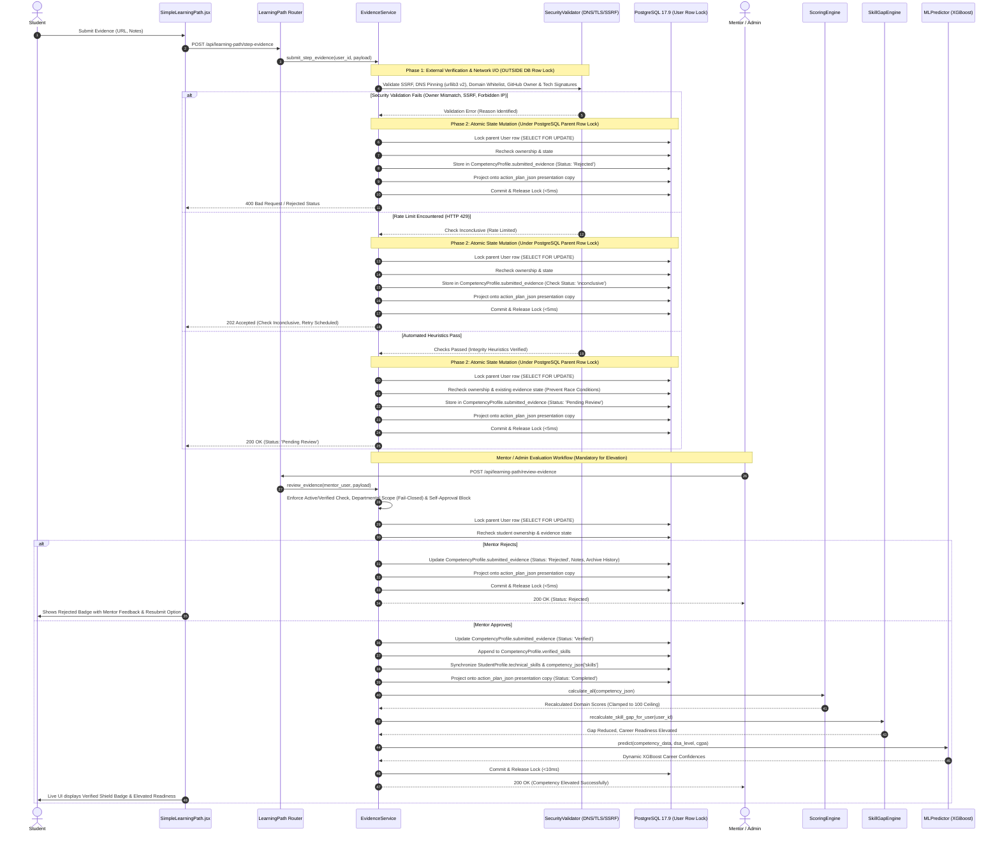

# Implementation Plan - Phase 4: Competency Elevation & Verified Evidence Loop (Final Authoritative - Reconciled)

Transform completed learning steps and practical capstone projects into verified proof-of-work, dynamically elevating candidate competencies, updating domain scoring, reducing skill gaps, and enhancing career readiness while strictly preserving Option A (zero database schema changes), XGBoost model artifacts, and dashboard integrity.

---

## User Review Required — Key Architectural Resolutions

> [!IMPORTANT]
> **Resolution 1 — Authoritative Evidence Store, Decoupled I/O & Presentation Projection**:
> - `CompetencyProfile.competency_json` is the **sole authoritative master evidence store**. It maintains:
>   - `competency_json["submitted_evidence"]`: Complete master record of every submission across all states (`Pending Review`, `Verified`, `Rejected`), including reviewer notes, automated check diagnostics, and full submission history.
>   - `competency_json["verified_skills"]`: The approved competency inventory maintaining immutable provenance audit records.
>   - `competency_json["skills"]`: The authoritative computational inventory of canonical skills.
> - `SkillGapAnalysis.action_plan_json` is a **derived presentation copy only**, projected dynamically for the active career role.
> - **Strict Unidirectional Flow**: Evidence flows strictly from the master store (`competency_json`) to the presentation copy (`action_plan_json`), **never in reverse**. Reverse-harvesting from `action_plan_json` into `competency_json` is strictly prohibited. If master evidence is missing or inconsistent, the existing master record is preserved and logged; it is never reconstructed from presentation data.
> - **Decoupled I/O & Minimal Lock Duration**: External URL/GitHub verification, DNS resolution, and streaming network I/O are performed **strictly outside the database transaction/row lock** to eliminate connection starvation and prolonged table/row blocking. The PostgreSQL parent `User` row lock (`SELECT FOR UPDATE`) is acquired only after network I/O completes, dedicated solely to the final ownership/state recheck and atomic database mutations (<5ms hold time). On error, `db.rollback()` executes immediately.

> [!IMPORTANT]
> **Resolution 2 — Exact ScoringEngine Formulas & Clamped Ceilings**:
> - No pseudocode or altered formulas. The exact Python implementation from `backend/services/scoring.py` is documented verbatim.
> - **Keyword Overlap**: Canonical skills that span multiple domains (e.g. `Python` in `backend` and `programming`; `JavaScript` in `frontend`, `backend`, and `programming`; `Scikit-learn` in `ai_ml` and `data_science`) naturally award points in each matching domain without artificial intervention.
> - **The 60-Point Domain Skill Cap**: Evaluated via `min(len(matched_skills) * 10, 60)`.
> - **The 100-Point Domain Ceiling**: Theoretical raw sum can reach $60\text{ (skills)} + 25\text{ (projects)} + 25\text{ (experience)} = 110\text{ points}$, but is explicitly clamped by `min(max(int(score), 0), 100)`.
> - **The 25-Point Overall Skill Cap**: In `calculate_overall()`, each skill contributes 2.5 points, strictly capped at $0.25 \times 100 = 25\text{ points}$ via `min(len(skills) * 2.5, 25)`.

> [!IMPORTANT]
> **Resolution 3 — Pure Structural Identifiers (Zero Substring / Position Fallbacks)**:
> - Every fallback based on task position, array index, task name, description, or substring search (such as `"capstone" in task.lower()` or `"project" in task.lower()`) is **completely eliminated**.
> - Detection throughout recalculation and carry-forward relies exclusively on:
>   ```python
>   is_capstone_task = task.get("task_type") == "capstone"
>   ```
> - The learning-path generator (`_generate_action_plan`) is required to assign explicit `task_type` (`"skill_step"` vs `"capstone"`) and `skill_identifier` (`canonical_skill_slug` vs `"capstone_milestone"`) to every generated task.

> [!IMPORTANT]
> **Resolution 4 — Rate Limits as Inconclusive Checks (Not Validation)**:
> - If GitHub returns HTTP 429 (`Too Many Requests`) or `X-RateLimit-Remaining: 0`, the automated check is explicitly classified as **`inconclusive`** (`automated_checks.status = "inconclusive"`).
> - **Inconclusive checks NEVER pass validation and NEVER enter `Pending Review`**.
> - Safe retry behavior: Submissions with inconclusive status remain in an `Inconclusive / Rate Limited` state with a calculated `retry_after` timestamp, allowing automatic or student-triggered retry with exponential backoff (30s, 60s, 120s, max 3 retries). Only an explicit **pass** enters `Pending Review`.

> [!IMPORTANT]
> **Resolution 5 — Verified DNS Pinning (Requests 2.32.3 / urllib3 2.5.0) & Preserved TLS**:
> - Reconciled with installed packages: `requests 2.32.3` and `urllib3 2.5.0`.
> - Uses a custom `PinnedHTTPSConnection(urllib3.connection.HTTPSConnection)` and `PinnedIPAdapter(requests.adapters.HTTPAdapter)` that overrides socket creation via `urllib3.util.connection.create_connection((self.pinned_ip, self.port))` while preserving `self.host` and `server_hostname` for RFC 6066 TLS SNI and standard X.509 certificate validation.
> - Redirect revalidation: Intercepts 3xx responses, re-resolves and validates the target IP on every hop.
> - Integration test: Directly checks `response.raw.connection.sock.getpeername()` to verify socket destination IP.

> [!IMPORTANT]
> **Resolution 6 — Department-Level Mentor Authorization & Strict Fail-Closed Policy**:
> - Documented schema reality: `User` and `StudentProfile` lack a `role` or mentor assignment column under Option A. Individual mentor-to-student relational assignment is not available without schema changes.
> - Safest compatible policy (Department-Level Authorization with Strict Fail-Closed):
>   - **Account Verification**: Reviewer must have `is_active == True` and `is_verified == True`.
>   - **Zero Default Privileged Emails**: `ADMIN_EMAILS` and `MENTOR_FACULTY_EMAILS` are parsed strictly from environment variables. If unset, the allowlists are empty (no default privileged accounts).
>   - **Administrators**: May review all students across all departments.
>   - **Mentors / Faculty (Strict Fail-Closed)**: Departmentally authorized via `MENTOR_DEPARTMENT_MAP`. May review students only within their configured department(s) matching `StudentProfile.department`. If a mentor email is missing from `MENTOR_DEPARTMENT_MAP`, has an empty department list, or if the student's department is empty/unmatched, access is **strictly denied with HTTP 403 `Forbidden`**. It **never fails open** and never grants access when department mapping is missing.
>   - **Students**: Prohibited from calling the review endpoint (receives HTTP 403 `Forbidden`).
>   - **Self-Approval**: Unconditionally prohibited (`if current_user.id == payload.user_id: raise 403`).

---

## 1. Final Architecture & End-to-End Workflow



---

## 2. Evidence Storage Architecture: Authoritative Store vs Presentation Copy

```
+---------------------------------------------------------------------------------------------------+
| SOLE AUTHORITATIVE MASTER STORE: CompetencyProfile.competency_json (backend/models/competency_profile.py)|
+-------------------------------+-------------------------------------------------------------------+
| JSON Sub-Document             | Operational Role & Invariant Rules                                |
+-------------------------------+-------------------------------------------------------------------+
| competency_json[              | Master evidence dictionary keyed by stable skill_identifier:      |
|   "submitted_evidence"        | - Holds full status, url, notes, reviewer_notes, timestamps       |
| ]                             | - Stores full submission_history array (archived attempts)         |
|                               | - Stores automated_checks diagnostics (passed, failed, inconv)    |
|                               | - ROLE-AGNOSTIC: Survives all role switches and gap recalculations|
|                               | - STRICT UNIDIRECTIONAL: Feeds action_plan_json, NEVER harvested |
|                               |   from action_plan_json.                                          |
+-------------------------------+-------------------------------------------------------------------+
| competency_json[              | Approved competency inventory:                                    |
|   "verified_skills"           | - Structured provenance audit records for elevated competencies   |
| ]                             | - Contains skill, canonical_skill, verified_at, verified_by, etc. |
+-------------------------------+-------------------------------------------------------------------+
| competency_json[              | Authoritative computational inventory:                            |
|   "skills"                    | - Normalized deduplicated array fed into ScoringEngine, Matcher   |
| ]                             |   and SkillGapEngine.                                             |
+-------------------------------+-------------------------------------------------------------------+

+---------------------------------------------------------------------------------------------------+
| DERIVED PRESENTATION COPY ONLY: SkillGapAnalysis.action_plan_json (backend/models/skill_gap.py)   |
+-------------------------------+-------------------------------------------------------------------+
| Structural Role               | Operational Behavior                                              |
+-------------------------------+-------------------------------------------------------------------+
| action_plan_json              | Presentation projection tied strictly to the ACTIVE target role:  |
|                               | - Generated by SkillGapEngine for the user's current career goal  |
|                               | - Synchronized by projecting data FROM CompetencyProfile master   |
|                               | - Rebuilt cleanly during recalculation without altering master    |
+-------------------------------+-------------------------------------------------------------------+
```

### A. Conflict Resolution, Decoupled I/O & Precedence Rules
1. **Absolute Master Precedence**: `CompetencyProfile.competency_json` is the sole source of truth.
2. **No Reverse-Harvesting**: `action_plan_json` is never inspected to populate or recover `competency_json`. If master evidence is missing or inconsistent, a warning is logged and the existing master state is preserved. Authoritative data is never reconstructed from presentation projections.
3. **Transaction Recovery & Decoupled I/O**: External network I/O and URL security checks are performed strictly *outside* the database row-lock transaction to prevent database connection pool exhaustion and prolonged row locking during slow outbound requests. The PostgreSQL parent `User` row lock (`SELECT FOR UPDATE`) is acquired only after network I/O succeeds, reserved exclusively for the final ownership/state recheck and atomic database mutations (<5ms hold time). On any validation error or unexpected exception, `db.rollback()` executes immediately.

### B. Master Evidence Schema in `CompetencyProfile.competency_json["submitted_evidence"]`
```json
{
  "django": {
    "task_type": "skill_step",
    "skill_identifier": "django",
    "canonical_skill": "Django",
    "resource_id": 47,
    "status": "Pending Review",
    "evidence_type": "github_repo",
    "url": "https://github.com/thanvith/django-rest-api",
    "notes": "Implemented custom Django user authentication, models, and RESTful API endpoints.",
    "submitted_at": "2026-11-02T15:00:00Z",
    "reviewed_at": null,
    "reviewed_by": null,
    "reviewer_notes": null,
    "automated_checks": {
      "status": "passed",
      "domain_valid": true,
      "ssrf_safe": true,
      "dns_pinned_ip": "140.82.121.4",
      "tls_verified": true,
      "owner_match": true,
      "repo_accessible": true,
      "technology_files_detected": ["manage.py", "settings.py"]
    },
    "submission_history": [
      {
        "url": "https://github.com/thanvith/empty-repo",
        "submitted_at": "2026-11-01T10:00:00Z",
        "status": "Rejected",
        "reason": "Repository is empty; does not contain implementation code."
      }
    ]
  },
  "capstone_milestone": {
    "task_type": "capstone",
    "skill_identifier": "capstone_milestone",
    "canonical_skill": "Python Developer Capstone",
    "status": "Pending Review",
    "evidence_type": "github_repo",
    "url": "https://github.com/thanvith/python-async-worker-api",
    "deployment_url": "https://worker-api.thanvith.dev",
    "notes": "FastAPI + Celery + Redis asynchronous background task queue with Docker Compose.",
    "submitted_at": "2026-11-02T15:15:00Z",
    "reviewed_at": null,
    "reviewed_by": null,
    "reviewer_notes": null,
    "submission_history": []
  }
}
```

---

## 3. Exact Existing ScoringEngine Implementation

Below is the verbatim implementation and exact mathematical formulas from `backend/services/scoring.py`.

### A. Verbatim Implementation of `_calculate_domain_score()`
```python
def _calculate_domain_score(self, profile_data, domain_keywords):
    score = 0
    reasons = []
    
    # 1. Domain Skills (up to 60 points)
    skills = self._normalize_skills(profile_data.get("skills", []))
    matched_skills = [s for s in skills if any(self._match_kw(kw, s) for kw in domain_keywords)]
    
    if matched_skills:
        skill_score = min(len(matched_skills) * 10, 60)
        score += skill_score
        reasons.append(f"Found {len(matched_skills)} domain skills ({skill_score}/60)")
    else:
        reasons.append("No specific domain skills found (0/60)")
        
    # 2. Domain-Relevant Projects (up to 25 points)
    projects = profile_data.get("projects", [])
    if projects:
        domain_proj_count = 0
        for p in projects:
            p_text = ""
            if isinstance(p, dict):
                p_text = f"{p.get('project_name', '')} {p.get('technology', '')} {p.get('description', '')}".lower()
            else:
                p_text = str(p).lower()
            if any(self._match_kw(kw, p_text) for kw in domain_keywords):
                domain_proj_count += 1

        if domain_proj_count > 0:
            proj_score = min(domain_proj_count * 15, 25)
            score += proj_score
            reasons.append(f"Has {domain_proj_count} relevant domain projects ({proj_score}/25)")
        else:
            proj_score = min(len(projects) * 5, 10)
            score += proj_score
            reasons.append(f"Has {len(projects)} general projects ({proj_score}/25)")
    else:
        reasons.append("No projects found (0/25)")
        
    # 3. Domain-Relevant Experience / Internships (up to 25 points)
    internships = profile_data.get("internships", []) + profile_data.get("experience", [])
    if internships:
        domain_exp_count = 0
        for exp in internships:
            exp_text = ""
            if isinstance(exp, dict):
                exp_text = f"{exp.get('company', '')} {exp.get('role', '')} {exp.get('description', '')}".lower()
            else:
                exp_text = str(exp).lower()
            if any(self._match_kw(kw, exp_text) for kw in domain_keywords):
                domain_exp_count += 1

        if domain_exp_count > 0:
            exp_score = min(domain_exp_count * 20, 25)
            score += exp_score
            reasons.append(f"Has {domain_exp_count} relevant domain experiences ({exp_score}/25)")
        else:
            exp_score = min(len(internships) * 5, 10)
            score += exp_score
            reasons.append(f"Has general experience ({exp_score}/25)")
    else:
        reasons.append("No experience found (0/25)")
        
    # Ensure score is within 0-100
    final_score = min(max(int(score), 0), 100)
    return final_score, ", ".join(reasons)
```

### B. Verbatim Implementation of `calculate_overall()`
```python
def calculate_overall(self, profile_data):
    score = 0
    reasons = []
    
    # CGPA (15%)
    cgpa_str = profile_data.get("cgpa")
    try:
        cgpa = float(cgpa_str) if cgpa_str else 0.0
        cgpa_score = min((cgpa / 10.0) * (self.weights["cgpa"] * 100), self.weights["cgpa"] * 100)
        score += cgpa_score
        reasons.append(f"CGPA {cgpa} ({int(cgpa_score)}/15)")
    except (ValueError, TypeError):
        reasons.append("Invalid or missing CGPA (0/15)")

    # Skills (25%)
    skills = profile_data.get("skills", [])
    skill_score = min(len(skills) * 2.5, self.weights["skills"] * 100)
    score += skill_score
    reasons.append(f"{len(skills)} Skills ({int(skill_score)}/25)")
    
    # Projects (20%)
    projects = profile_data.get("projects", [])
    proj_score = min(len(projects) * 10, self.weights["projects"] * 100)
    score += proj_score
    reasons.append(f"{len(projects)} Projects ({int(proj_score)}/20)")

    # Internships (15%)
    internships = profile_data.get("internships", []) + profile_data.get("experience", [])
    int_score = min(len(internships) * 15, self.weights["internships"] * 100)
    score += int_score
    reasons.append(f"{len(internships)} Experiences ({int(int_score)}/15)")
    
    # Certifications (10%)
    certs = profile_data.get("certifications", [])
    cert_score = min(len(certs) * 5, self.weights["certifications"] * 100)
    score += cert_score
    reasons.append(f"{len(certs)} Certifications ({int(cert_score)}/10)")
    
    # Programming Languages (10%)
    prog_score = min(len([s for s in skills if s.lower() in self.domains["programming"]]) * 5, self.weights["programming_languages"] * 100)
    score += prog_score
    reasons.append(f"Programming skills ({int(prog_score)}/10)")
    
    # Resume Completeness (5%)
    completeness = 0
    if profile_data.get("education"): completeness += 2.5
    if profile_data.get("experience"): completeness += 2.5
    score += completeness
    reasons.append(f"Completeness ({int(completeness)}/5)")

    return min(max(int(score), 0), 100), ", ".join(reasons)
```

### C. Detailed Analysis of Scoring Dynamics

1. **Keyword Overlap Mechanics**:
   - `self.domains` intentionally contains multi-domain keywords based on computer science technology classification:
     - `python`: Matches `backend` (`["python", "java", "django", ...]`) and `programming` (`["python", "java", "c++", ...]`).
     - `javascript`: Matches `frontend` (`["javascript", "react", ...]`), `backend` (`["node", "express", ...]`), and `programming`.
     - `scikit-learn` & `xgboost`: Match both `ai_ml` and `data_science`.
     - `docker` & `kubernetes`: Match `cloud`.
   - When a student verifies `Python`, it is matched in both `backend` and `programming`, awarding 10 points in each domain up to their independent domain caps.
   - Duplicate occurrences within the same domain are strictly impossible because `_normalize_skills()` lowercases the list and `matched_skills` evaluates set membership via `any(...)`.

2. **The 60-Point Domain Skill Cap**:
   - In every domain, the skills component is bounded by:
     $$\text{skill\_score} = \min(|\text{matched\_skills}| \times 10, 60)$$
   - Having 6 matched skills yields 60 points; having 10 matched skills still yields exactly 60 points.

3. **The 100-Point Clamped Domain Ceiling**:
   - The theoretical raw score sum is:
     $$\text{Raw Score} = \text{Skills (up to 60)} + \text{Projects (up to 25)} + \text{Experience (up to 25)} = 110$$
   - The function explicitly clamps this sum:
     $$\text{final\_score} = \min(\max(\text{int}(\text{score}), 0), 100)$$
   - A student with maximum skills (60), maximum projects (25), and maximum experience (25) scores exactly **100**, never 110.

4. **The 25-Point Overall Skill Cap**:
   - In `calculate_overall()`, every skill in `profile_data["skills"]` (including the 25 supporting skills) awards 2.5 points, bounded by:
     $$\text{overall\_skill\_score} = \min(|\text{skills}| \times 2.5, 25)$$
   - A candidate with 10 or more skills receives the maximum 25 points.

---

## 4. Pure Structural Identifiers & Unidirectional Carry-Forward

### A. Generator Responsibility & Total Substring Elimination
1. The learning-path generator (`SkillGapEngine._generate_action_plan`) must assign explicit structural attributes to every generated task:
   - For skill steps: `task["task_type"] = "skill_step"` and `task["skill_identifier"] = get_canonical_skill(skill).strip().lower()`.
   - For the capstone milestone: `task["task_type"] = "capstone"` and `task["skill_identifier"] = "capstone_milestone"`.
2. All fallback checks based on array position (`idx == len(...) - 1`), task name, or substrings (`"capstone" in ...` or `"project" in ...`) are **100% eliminated**.

### B. Unidirectional Projection in `recalculate_skill_gap_for_user()`
```python
def recalculate_skill_gap_for_user(db: Session, user_id: int, target_role_override: Optional[str] = None, sync_preference_to_profile: bool = False):
    # ... [Profile and JobRole resolution] ...

    # 1. Fetch Authoritative Master Evidence Store from CompetencyProfile ONLY
    # Unidirectional flow rule: action_plan_json is NEVER harvested into competency_json.
    master_evidence = {}
    if competency.competency_json and "submitted_evidence" in competency.competency_json:
        master_evidence = copy.deepcopy(competency.competency_json["submitted_evidence"])
    else:
        logger.warning(f"Authoritative master evidence store missing or empty for user {user_id}. Preserving empty master state.")

    # 2. Execute Skill Gap Engine to generate base action plan for new/updated role
    # The generator explicitly assigns task_type and skill_identifier to every task
    engine = SkillGapEngine()
    result = engine.execute(db, job_data, comp_data)
    new_action_plan = list(result["action_plan"])

    # 3. Synchronize Master Evidence onto the Derived Presentation Copy (Pure Structural Check)
    for task in new_action_plan:
        is_capstone_task = task.get("task_type") == "capstone"
        
        if is_capstone_task:
            task["skill_identifier"] = "capstone_milestone"
            if "capstone_milestone" in master_evidence:
                ev = master_evidence["capstone_milestone"]
                task["evidence"] = ev
                if ev.get("status") == "Verified":
                    task["status"] = "Completed"
                elif ev.get("status") in ("Pending Review", "Submitted"):
                    task["status"] = "In Progress"
        else:
            canonical_key = (task.get("skill_identifier") or "").strip().lower()
            if canonical_key in master_evidence:
                ev = master_evidence[canonical_key]
                task["evidence"] = ev
                if ev.get("status") == "Verified":
                    task["status"] = "Completed"
                elif ev.get("status") in ("Pending Review", "Submitted"):
                    task["status"] = "In Progress"

    # 4. Persist updated derived presentation copy ONLY (Master store is NOT overwritten by recalculation)
    gap_record.action_plan_json = new_action_plan
    flag_modified(gap_record, "action_plan_json")

    db.commit()
    db.refresh(gap_record)
    return gap_record
```

---

## 5. Technically Valid DNS Pinning (Requests 2.32.3 / urllib3 2.5.0) & Preserved TLS

### A. urllib3 v2 Architecture & Connection Pool Subclassing
In `urllib3 2.5.0`, `HTTPSConnection._new_conn()` establishes the underlying TCP socket using `urllib3.util.connection.create_connection((self._dns_host, self.port))`. To pin the socket connection to a pre-validated IP without breaking TLS SNI and hostname certificate validation:

```python
import socket
import ipaddress
import requests
from requests.adapters import HTTPAdapter
from urllib3.connection import HTTPSConnection
from urllib3.connectionpool import HTTPSConnectionPool
from urllib3.util.connection import create_connection

class PinnedHTTPSConnection(HTTPSConnection):
    """
    Subclasses urllib3.connection.HTTPSConnection for urllib3 2.5.0.
    Pins socket connection to the pre-validated IP while preserving self.host
    and server_hostname for RFC 6066 TLS SNI and standard X.509 certificate validation.
    """
    pinned_ip: str = ""

    def _new_conn(self) -> socket.socket:
        sock = create_connection(
            (self.pinned_ip, self.port),
            self.timeout,
            source_address=self.source_address,
            socket_options=self.socket_options
        )
        return sock

class PinnedIPAdapter(HTTPAdapter):
    """
    Requests HTTPAdapter that dynamically configures HTTPSConnectionPool
    to use PinnedHTTPSConnection with the validated destination IP.
    """
    def __init__(self, pinned_ip: str, *args, **kwargs):
        self.pinned_ip = pinned_ip
        super().__init__(*args, **kwargs)

    def init_poolmanager(self, connections, maxsize, block=False, **pool_kwargs):
        super().init_poolmanager(connections, maxsize, block=block, **pool_kwargs)
        
        # Bind pinned IP into connection class
        class BoundConnection(PinnedHTTPSConnection):
            pinned_ip = self.pinned_ip

        class BoundPool(HTTPSConnectionPool):
            ConnectionCls = BoundConnection

        self.poolmanager.pool_classes_by_scheme["https"] = BoundPool
```

### B. Redirect Revalidation & Safe Hop Execution
```python
def fetch_verified_url_content(target_url: str, max_redirects: int = 3) -> tuple[int, bytes, str]:
    """
    Fetches content with mandatory DNS resolution, IP pinning, TLS preservation,
    and strict redirect revalidation on every hop.
    """
    current_url = target_url
    visited_hops = 0
    
    while visited_hops <= max_redirects:
        parsed = requests.utils.urlparse(current_url)
        if parsed.scheme != "https":
            raise ValueError(f"Insecure scheme '{parsed.scheme}'. Only https:// is permitted.")
        
        hostname = parsed.hostname
        if not hostname or not is_whitelisted_domain(hostname):
            raise ValueError(f"Domain '{hostname}' is not in the approved domain whitelist.")
        
        # 1. Dual-Stack DNS Resolution & Security Check
        addr_info = socket.getaddrinfo(hostname, 443, family=socket.AF_UNSPEC, type=socket.SOCK_STREAM)
        for family, socktype, proto, canonname, sockaddr in addr_info:
            ip = ipaddress.ip_address(sockaddr[0])
            if ip.is_private or ip.is_loopback or ip.is_link_local or ip.is_reserved or ip.is_multicast:
                raise SecurityError(f"Resolved IP {ip} for {hostname} is in a restricted private/local address space.")
        
        pinned_ip = str(addr_info[0][4][0])
        
        # 2. Issue Request with Pinned IP and TLS Verification Active
        session = requests.Session()
        session.mount(f"https://{hostname}", PinnedIPAdapter(pinned_ip))
        
        response = session.get(current_url, allow_redirects=False, timeout=(3.0, 5.0), stream=True)
        
        # Integration Check: Verify actual destination socket IP
        actual_peer = response.raw.connection.sock.getpeername()
        if actual_peer[0] != pinned_ip:
            response.close()
            raise SecurityError(f"Socket peer mismatch: connected to {actual_peer[0]}, expected pinned IP {pinned_ip}")
            
        if response.is_redirect:
            visited_hops += 1
            if visited_hops > max_redirects:
                response.close()
                raise ValueError("Too many redirects (exceeded limit of 3).")
            current_url = response.headers.get("Location")
            response.close()
            continue
        
        # Stream response with 1MB size limit
        content = bytearray()
        for chunk in response.iter_content(chunk_size=8192):
            content.extend(chunk)
            if len(content) > 1048576: # 1 MB
                response.close()
                raise ValueError("Response body exceeded 1.0 MB size limit.")
        
        response.close()
        return response.status_code, bytes(content), pinned_ip

    raise ValueError("Redirect chain terminated abnormally.")
```

### C. GitHub Rate-Limit Inconclusive Check Handling
- If a GitHub API endpoint returns HTTP 429 (`Too Many Requests`) or headers include `X-RateLimit-Remaining: 0`:
  - Check status is explicitly recorded as **`status: "inconclusive"`**.
  - **Does NOT pass validation; does NOT enter `Pending Review`**.
  - Sets `retry_after = 60` and stores diagnostic details in `automated_checks`.
  - Student or mentor can trigger `/retry-automated-check` after reset.

### D. Decoupled Transaction Lifecycle: Network I/O Outside Database Row Locks

To guarantee high system throughput, eliminate database connection pool starvation, and prevent transaction deadlocks:

1. **The Concurrency & Locking Hazard**:
   Outbound HTTP requests (DNS lookup, TCP/TLS handshake, GitHub API / raw content fetch) typically take between 150ms to 3,000ms (and up to 8,000ms during network retries or redirects). If a database transaction holds a PostgreSQL parent `User` row lock (`SELECT FOR UPDATE`) while waiting for outbound network I/O:
   - The user's account row is locked for several seconds, blocking concurrent student actions (such as dashboard page loads, profile updates, or resume uploads).
   - Database connection pool slots remain tied up during idle network waits, creating a severe connection starvation and denial-of-service vulnerability under multi-user concurrency.

2. **Two-Phase Decoupled Lifecycle Implementation**:
   - **Phase 1: Pre-Transaction External Validation (No Database Lock Held)**:
     - All input parsing, domain whitelisting, SSRF IP validation, DNS pinning, and external HTTP fetches execute in application memory before any database row lock is acquired.
     - Rate limits, redirect validations, and technology signature inspections occur strictly within Phase 1.
   - **Phase 2: Atomic State Mutation & Ownership Recheck (Under PostgreSQL Parent Row Lock)**:
     - Only once external checks complete is the database session engaged.
     - `parent_user = db.query(User).filter(User.id == user_id).with_for_update().first()`
     - A strict ownership and state recheck is performed (verifying the target profile exists, checking whether a concurrent submission has arrived or status has transitioned).
     - Atomic mutations are written to `CompetencyProfile.competency_json["submitted_evidence"]`, `verified_skills`, `StudentProfile.technical_skills`, and projected to `action_plan_json`.
     - `db.commit()` executes immediately, releasing the row lock in under 5 milliseconds.

```python
def submit_evidence_lifecycle(user_id: int, payload: EvidenceSubmissionPayload, db: Session):
    # =========================================================================
    # PHASE 1: PRE-TRANSACTION EXTERNAL VERIFICATION (NO DB ROW LOCK HELD)
    # =========================================================================
    validation_status = "Pending Review"
    checks_diagnostic = {}
    validation_error_reason = None
    is_inconclusive = False
    
    try:
        # Dual-stack DNS resolution, SSRF blocking, IP pinning, streaming fetch
        status_code, content, pinned_ip = fetch_verified_url_content(payload.url)
        checks_diagnostic["dns_pinned_ip"] = pinned_ip
        checks_diagnostic["status_code"] = status_code
        checks_diagnostic["tls_verified"] = True
        
        # Technology signature heuristics (e.g. GitHub repo inspection)
        tech_passed, tech_files = inspect_repo_signatures(payload.url, payload.canonical_skill)
        checks_diagnostic["technology_files_detected"] = tech_files
        if not tech_passed:
            validation_status = "Rejected"
            validation_error_reason = f"Repository lacks required files for {payload.canonical_skill}."
            
    except RateLimitExceededException as rle:
        # HTTP 429 encountered: Inconclusive check, NOT a pass
        is_inconclusive = True
        checks_diagnostic["status"] = "inconclusive"
        checks_diagnostic["retry_after"] = rle.retry_after
    except SecurityError as se:
        validation_status = "Rejected"
        validation_error_reason = f"Security validation failure: {str(se)}"
    except Exception as exc:
        validation_status = "Rejected"
        validation_error_reason = f"Verification failure: {str(exc)}"

    # =========================================================================
    # PHASE 2: ATOMIC OWNERSHIP RECHECK & MUTATION (UNDER POSTGRESQL ROW LOCK)
    # =========================================================================
    try:
        # Acquire parent User row lock strictly for atomic state mutation
        user = db.query(User).filter(User.id == user_id).with_for_update().first()
        if not user:
            raise HTTPException(status_code=404, detail="User not found.")
            
        student_profile = db.query(StudentProfile).filter(StudentProfile.user_id == user_id).first()
        comp_profile = db.query(CompetencyProfile).filter(CompetencyProfile.user_id == user_id).first()
        if not comp_profile:
            raise HTTPException(status_code=404, detail="CompetencyProfile not found.")
            
        comp_json = copy.deepcopy(comp_profile.competency_json or {})
        submitted_evidence = comp_json.setdefault("submitted_evidence", {})
        
        # Recheck existing submission state to prevent race conditions
        existing_ev = submitted_evidence.get(payload.skill_identifier)
        if existing_ev and existing_ev.get("status") == "Verified":
            raise HTTPException(status_code=400, detail="Skill is already verified.")

        # Construct new submission record
        new_record = {
            "task_type": payload.task_type,
            "skill_identifier": payload.skill_identifier,
            "canonical_skill": payload.canonical_skill,
            "url": payload.url,
            "notes": payload.notes,
            "status": "Inconclusive" if is_inconclusive else validation_status,
            "rejection_reason": validation_error_reason,
            "automated_checks": checks_diagnostic,
            "submitted_at": datetime.now(timezone.utc).isoformat(),
            "submission_history": existing_ev.get("submission_history", []) if existing_ev else []
        }
        
        submitted_evidence[payload.skill_identifier] = new_record
        comp_profile.competency_json = comp_json
        flag_modified(comp_profile, "competency_json")
        
        # Project master evidence onto derived presentation copy (action_plan_json)
        sync_master_to_presentation_copy(db, user_id, submitted_evidence)
        
        db.commit()
        db.refresh(comp_profile)
        return new_record
        
    except Exception:
        db.rollback()
        raise
```

---

## 6. Department-Level Mentor Authorization (Zero Database Schema)

### A. Documented Database Schema Reality & Limitation
- Inspection of `User` (`backend/models/user.py`) confirms columns: `id`, `full_name`, `email`, `password_hash`, `is_verified`, `is_active`, `created_at`, `updated_at`, `last_login`.
- `StudentProfile` contains student attributes (`department`, `cgpa`, etc.).
- There is **no `role` column on `User`**, and **no relational mentor-to-student assignment table**.
- **Limitation**: Individual mentor-to-student assignment is not available without database schema modifications. Authorization operates strictly at the department level via environment configuration.

### B. Department-Level Access Policy & Guardrails
To provide rigorous access control without altering the database schema:

```
+-----------------------------------+---------------------------------------------------------------+
| User Category                     | Authorization & Review Scope                                  |
+-----------------------------------+---------------------------------------------------------------+
| Administrators                    | Explicitly configured in ADMIN_EMAILS environment variable.   |
|                                   | - Condition: reviewer.is_active == True and is_verified == True|
|                                   | - Scope: Authorized to review and approve ALL students.       |
|                                   | - Restriction: Cannot review self (self-approval blocked).    |
+-----------------------------------+---------------------------------------------------------------+
| Mentors & Faculty                 | Explicitly configured in MENTOR_FACULTY_EMAILS env variable.  |
|                                   | - Condition: reviewer.is_active == True and is_verified == True|
|                                   | - Scope: Departmentally scoped via MENTOR_DEPARTMENT_MAP.     |
|                                   |   May review only students whose StudentProfile.department    |
|                                   |   matches the mentor's designated assigned department.        |
|                                   | - Strict Fail-Closed Policy: If a mentor email is missing from |
|                                   |   MENTOR_DEPARTMENT_MAP or maps to an empty list, or if the   |
|                                   |   student's department is empty or unmatched, access is       |
|                                   |   STRICTLY DENIED (HTTP 403 Forbidden). Access is NEVER       |
|                                   |   granted when department mapping is missing.                 |
|                                   | - Restriction: Cannot review self; cannot review other depts. |
+-----------------------------------+---------------------------------------------------------------+
| Students / General Users          | Any user not in ADMIN_EMAILS or MENTOR_FACULTY_EMAILS.        |
|                                   | - Scope: Submissions only.                                    |
|                                   | - Restriction: Calling review endpoint returns 403 Forbidden. |
+-----------------------------------+---------------------------------------------------------------+
| Self-Approval Block (Universal)   | If reviewer.id == student.user_id: 403 Forbidden is enforced  |
|                                   | unconditionally for all users including administrators.       |
+-----------------------------------+---------------------------------------------------------------+
```

### C. Review Authorization Implementation (Strict Fail-Closed)
```python
# Zero default privileged email addresses: parsed strictly from environment
admin_env = os.getenv("ADMIN_EMAILS", "").strip()
ADMIN_EMAILS = set(e.strip().lower() for e in admin_env.split(",") if e.strip())

mentor_env = os.getenv("MENTOR_FACULTY_EMAILS", "").strip()
MENTOR_FACULTY_EMAILS = set(e.strip().lower() for e in mentor_env.split(",") if e.strip())

# Department-level mentor scope mapping
MENTOR_DEPARTMENT_MAP = {
    "mentor@skillnova.ai": ["Computer Science and Engineering", "Information Science and Engineering", "Computer Science"],
    "faculty@skillnova.ai": ["Artificial Intelligence and Machine Learning", "Data Science"]
}

def verify_reviewer_authorization(reviewer: User, target_student_profile: StudentProfile):
    # 1. Reviewer Account Active & Verified Checks
    if not getattr(reviewer, "is_active", False):
        raise HTTPException(status_code=status.HTTP_403_FORBIDDEN, detail="Inactive reviewer account.")
    if not getattr(reviewer, "is_verified", False):
        raise HTTPException(status_code=status.HTTP_403_FORBIDDEN, detail="Unverified reviewer account.")

    # 2. Universal Self-Approval Prevention
    if reviewer.id == target_student_profile.user_id:
        raise HTTPException(
            status_code=status.HTTP_403_FORBIDDEN,
            detail="Self-approval prohibited. Reviewers cannot approve their own submissions."
        )
    
    rev_email = (reviewer.email or "").strip().lower()

    # 3. Administrator Access (All Departments)
    if rev_email in ADMIN_EMAILS or getattr(reviewer, "is_superuser", False):
        return True
        
    # 4. Department-Level Mentor Access (Strict Fail-Closed)
    if rev_email in MENTOR_FACULTY_EMAILS:
        allowed_depts = [d.lower() for d in MENTOR_DEPARTMENT_MAP.get(rev_email, [])]
        student_dept = (target_student_profile.department or "").strip().lower()
        
        # STRICT FAIL-CLOSED: Must have an explicit, non-empty department list AND student's department must match
        if allowed_depts and student_dept and student_dept in allowed_depts:
            return True
            
        raise HTTPException(
            status_code=status.HTTP_403_FORBIDDEN,
            detail=f"Mentor scope restriction: You are not authorized to review students in the '{target_student_profile.department}' department."
        )
        
    # 5. Unauthorized User (Students / Unmapped Accounts)
    raise HTTPException(
        status_code=status.HTTP_403_FORBIDDEN,
        detail="Access denied: Only authorized mentors or faculty may review evidence submissions."
    )
```

---

## 7. XGBoost Invariance & Unchanged Feature Contract

- **Exact 11 Input Features**:
  1. `cgpa`
  2. `frontend_score`
  3. `backend_score`
  4. `database_score`
  5. `ai_ml_score`
  6. `data_science_score`
  7. `cloud_score`
  8. `programming_score`
  9. `soft_skill_score`
  10. `overall_competency_score`
  11. `dsa_level_encoded`
- **Model Invariance**: Zero model retraining. All model artifacts (`best_model.joblib`), scaler (`scaler.joblib`), encoders (`encoder.joblib`, `label_encoder.joblib`), metadata (`feature_metadata.json`), and synthetic dataset (`synthetic_dataset.csv`) retain their exact SHA-256 hashes.
- **Dynamic Inference**: Updating domain scores updates the 11-feature vector, which `scaler.transform()` scales and `model.predict_proba()` evaluates against fixed benchmark decision boundaries.

---

## 8. Frontend Changes & Evidence Status Presentation

- `SimpleLearningPath.jsx`:
  - Adds collapsible "Submit Proof of Work" drawer to step cards and capstone card.
  - Form fields: Evidence Type (`GitHub Repository`, `Live Project URL`, `Certificate Link`), URL input, Notes text area.
  - Displays live badges: `Not Submitted` (slate), `Pending Review` (amber pulse), `Verified` (emerald shield), `Rejected` (rose with feedback and resubmit button), `Inconclusive / Rate Limited` (blue with countdown retry button).
- `SkillGap.jsx`:
  - Verified skills show a green shield badge in the missing skills grid.
- `Dashboard.jsx`:
  - **100% Preserved**. All four Career Intelligence Overview cards remain identical in structure, layout, styling, and props.

---

## 9. Expanded 12-Category Automated Verification Suite

An automated test suite `scratch/test_phase4_evidence_loop.py` will execute:

```
Category 1: Input Validation & Boundary Constraints (Invalid URL formats, missing fields)
Category 2: SSRF & Dual-Stack IP Security (Rejects 127.0.0.1, 10.0.0.1, 169.254.169.254, IPv6 ::1)
Category 3: DNS Pinning & Socket Peer Verification (Verifies response.raw.connection.sock.getpeername() matches pinned IP)
Category 4: Unsafe Redirects & Host Revalidation (Blocks redirect hops to internal/private addresses)
Category 5: GitHub Rate-Limit Inconclusive Handling (HTTP 429 sets inconclusive, blocks auto-verification)
Category 6: Strict Pending Review Enforcement (Passing heuristics NEVER auto-verifies)
Category 7: Departmental Mentor Authorization & Self-Approval Prevention (Admins review all; mentors review assigned depts; missing or empty department mapping strictly fails closed with 403; inactive/unverified reviewers blocked; self-approval rejected with 403)
Category 8: Tri-Layer Competency Elevation Synchronization (StudentProfile + competency_json)
Category 9: ScoringEngine Determinism, Idempotency & 100-Point Clamped Ceiling
Category 10: Concurrency & PostgreSQL Parent-Row Locking Safeguard (External I/O performed strictly outside DB lock; minimal lock hold time for atomic state mutation and ownership recheck under SELECT FOR UPDATE)
Category 11: Cross-Role Evidence Carry-Forward Resilience (Strict structural check: task.get("task_type") == "capstone")
Category 12: Zero Database Schema Changes & XGBoost Artifact Hash Invariance
```

---

## 10. Exact Files to be Created or Modified

### New Backend Services & Tests
- `backend/services/evidence.py` [NEW]: Implements `EvidenceService` (SSRF/DNS security with `PinnedIPAdapter`, decoupled two-phase transaction lifecycle executing network I/O outside DB lock, PostgreSQL parent `User` row locking for atomic mutations, mentor review with strict fail-closed departmental authorization, tri-layer synchronization).
- `scratch/test_phase4_evidence_loop.py` [NEW]: Complete 12-category automated test suite.

### Modified Backend Routers
- `backend/routers/learning_path.py` [MODIFY]: Adds `/step-evidence`, `/capstone-evidence`, and `/review-evidence` endpoints.
- `backend/routers/competency_profile.py` [MODIFY]: Updates `generate_competency_profile()` to preserve existing `verified_skills`.
- `backend/routers/skill_gap.py` [MODIFY]: Updates `recalculate_skill_gap_for_user()` to project master evidence onto `action_plan_json` using pure structural check `task.get("task_type") == "capstone"`.

### Modified Frontend Components
- `frontend/src/components/learning_path/SimpleLearningPath.jsx` [MODIFY]: Adds evidence submission drawer and status badges.
- `frontend/src/services/api.js` [MODIFY]: Adds `submitStepEvidence()`, `submitCapstoneEvidence()`, and `reviewEvidence()` API helpers.

---

## 11. Limitations of Option A and Residual Risks

1. **JSON Read-Modify-Write Latency**: Serializing `action_plan_json` incurs a minor overhead (~15-30ms) compared to direct relational row inserts. Handled safely via parent-row locking.
2. **Department-Level Authorization Scope**: Because `User` lacks a mentor assignment column under Option A, mentor authorization operates at the department scope via configuration (`MENTOR_DEPARTMENT_MAP`) rather than individual 1-to-1 mentor-student database relationships.
3. **Admin Moderation Scan**: Querying all pending reviews across students requires scanning `CompetencyProfile.competency_json["submitted_evidence"]` in Python rather than an indexed B-tree SQL lookup. Sufficient for institutional scale.
